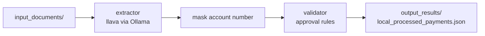

# Invoice Llama Agent

A small, fully local agent that reads invoices and cheques (PDF or image), extracts the key payment fields with a vision model, and applies simple approval rules.

Documents are processed by a model running on your own machine through [Ollama](https://ollama.com). Nothing is sent to a cloud service.

## What it does

For every file in `input_documents/`, the agent:

1. Converts the first page to an image.
2. Asks the local `llava` vision model to return the payment fields as JSON.
3. Masks the bank account number so only the last 4 digits remain.
4. Applies the approval rules and assigns a status.
5. Writes all results to `output_results/local_processed_payments.json`.



### Extracted fields

| Field | Description |
|---|---|
| `document_type` | `Invoice` or `Cheque` |
| `document_number` | Invoice or cheque number |
| `date` | `YYYY-MM-DD` |
| `vendor_or_payee_name` | Vendor (invoice) or payee (cheque) |
| `total_amount` | Total as a number |
| `gst_or_tax_amount` | Tax amount, `0.0` if not found |
| `account_number` | Masked, for example `****9012` |
| `is_signature_present` | `true` or `false` |

### Approval rules

Rules are checked in this order; the first match decides the status.

| Condition | Status |
|---|---|
| Extraction raised an error | `FAILED` |
| No data extracted | `REJECTED` |
| Amount missing or not above zero | `NEEDS_REVIEW` |
| Cheque without a signature | `REJECTED` |
| Amount above 50,000 | `HUMAN_APPROVAL_REQUIRED` |
| Everything else | `APPROVED_FOR_PAYMENT` |

## Core tools

| Tool | Role |
|---|---|
| [LangGraph](https://github.com/langchain-ai/langgraph) | Defines the two-step workflow (`extractor` → `validator`) |
| [langchain-ollama](https://github.com/langchain-ai/langchain) | Connects the workflow to the local Ollama model |
| [Ollama](https://ollama.com) + `llava` | Local vision model that reads the document image |
| [PyMuPDF](https://pymupdf.readthedocs.io) | Renders PDF pages to images and generates the demo invoices |
| [Pydantic](https://docs.pydantic.dev) | Dependency of the LangChain stack |

## Project structure

```
.
├── local_agent.py              # The agent: extraction, masking, validation, output
├── create_sample_invoices.py   # Generates the two demo invoices
├── input_documents/            # Put documents here (only the demos are tracked in git)
├── output_results/             # Results are written here (ignored by git)
├── requirements.txt            # Pinned dependencies
├── docs/ARCHITECTURE.md        # How the code works
└── SECURITY.md                 # Security policy and data handling
```

## Getting started

### Prerequisites

- Python 3.10 or newer
- [Ollama](https://ollama.com/download) installed and running
- The `llava` model:

  ```bash
  ollama pull llava
  ```

### Install

```bash
git clone https://github.com/jayakumarvin/invoice_llama_agent.git
cd invoice_llama_agent
python3 -m venv venv
source venv/bin/activate
pip install -r requirements.txt
```

### Run

```bash
# Optional: regenerate the demo invoices
python create_sample_invoices.py

# Process everything in input_documents/
python local_agent.py
```

Supported input formats: `.pdf`, `.png`, `.jpg`, `.jpeg`. For PDFs, only the first page is read.

### Example output

```json
{
    "file_name": "demo_invoice_1.pdf",
    "status": "APPROVED_FOR_PAYMENT",
    "remarks": "All details verified.",
    "data": {
        "document_type": "Invoice",
        "document_number": "INV-2026-101",
        "date": "2026-11-14",
        "vendor_or_payee_name": "Sri Murugan Office Supplies",
        "total_amount": 11800.0,
        "gst_or_tax_amount": 1800.0,
        "account_number": null,
        "is_signature_present": false
    }
}
```

This shows the intended result for the demo invoice. Actual values depend on what the model reads; see the limitations below.

## Security

- All processing is local; no document leaves your machine.
- Account numbers are masked before they are stored or written anywhere.
- Result files are created with owner-only permissions.
- Real documents and results are excluded from git by `.gitignore`.

See [SECURITY.md](SECURITY.md) for the full policy and how to report a vulnerability.

## Known limitations

This is a demonstration project, not a production payment system.

- **The model can misread amounts.** In testing, `llava` read both demo invoices (11,800 and 94,400) as 1,000. A misread amount can put a document under the 50,000 limit and mark it `APPROVED_FOR_PAYMENT` when it should need human approval. Do not release payments on this status alone.
- **The model can invent values.** It has returned an account number for invoices that contain none.
- Only the first page of a PDF is read.
- There is no automated test suite yet.

## Contributing

See [CONTRIBUTING.md](CONTRIBUTING.md).
