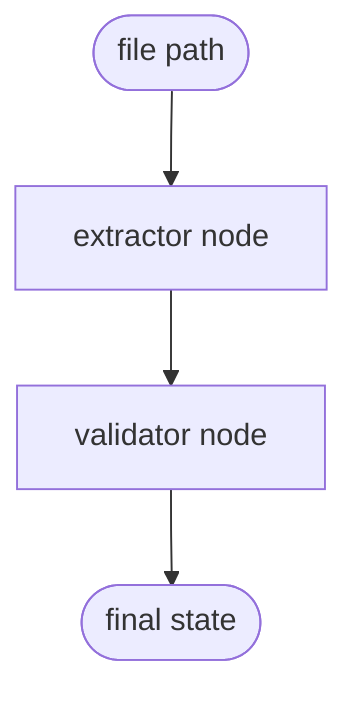

# Architecture

The agent is a two-node [LangGraph](https://github.com/langchain-ai/langgraph) workflow defined in `local_agent.py`. Each input file is run through the graph once.

## State

Both nodes read and update one shared state object, `AgentState`:

| Key | Type | Set by |
|---|---|---|
| `file_path` | `str` | The caller |
| `extracted_data` | `dict` or `None` | `extractor` |
| `text_amounts` | `list` or `None` | `extractor` |
| `validation_status` | `str` | `extractor` (on error) or `validator` |
| `remarks` | `str` | `extractor` (on error) or `validator` |

## Extractor node (`extract_node`)

1. `prepare_image_base64()` turns the file into a base64 image. A PDF's first page is rendered at 200 DPI with PyMuPDF; image files are read as they are.
2. The image and a fixed prompt are sent to the local `llava` model through `ChatOllama`. The model runs with `temperature=0` and `format="json"` so it returns a JSON object.
3. The response is parsed. Anything that is not a JSON object is rejected.
4. For PDFs, `read_document_text()` reads the embedded text. An account number whose digits do not appear in that text is discarded as invented.
5. `mask_account_number()` replaces the account number with `****` plus its last 4 characters before the data is stored in the state.
6. `amounts_in_text()` collects every amount printed in the text (figures with two decimals, such as `11,800.00`) into `text_amounts`.

Any exception sets the status to `FAILED` with the error in `remarks`.

## Validator node (`validate_node`)

Applies the approval rules in order and sets `validation_status` and `remarks`. The rules are listed in the [README](../README.md#approval-rules). The human-approval limit is the `APPROVAL_LIMIT` constant.

The model's total is trusted only when it matches one of `text_amounts`. If there is no text (an image or scanned PDF) or no match, the status is `NEEDS_REVIEW`. The limit is compared with the larger of the model's total and the largest printed amount, so picking a subtotal cannot avoid human approval.

## Main loop

When run as a script, `local_agent.py`:

1. Collects `.pdf`, `.png`, `.jpg` and `.jpeg` files from `input_documents/`.
2. Invokes the graph for each file.
3. Writes all results to `output_results/local_processed_payments.json`, creating the folder with `700` and the file with `600` permissions.

## Demo data

`create_sample_invoices.py` uses PyMuPDF to draw two fictional tax invoices into `input_documents/`. They contain no real vendor or bank data and are the only documents tracked in git.

## Changing the behaviour

| To change | Edit |
|---|---|
| The model | `ChatOllama(model="llava", ...)` |
| The extracted fields | The prompt in `extract_node` |
| The approval rules | `validate_node` |
| The approval limit | `APPROVAL_LIMIT` |
| Which printed amounts are recognised | `AMOUNT_PATTERN` |
| Input and output folders | `input_folder` and `output_folder` in the main block |
